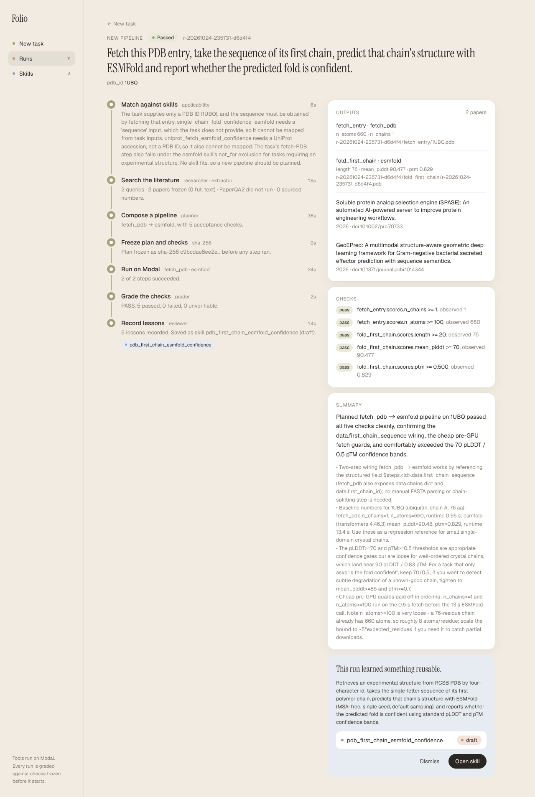
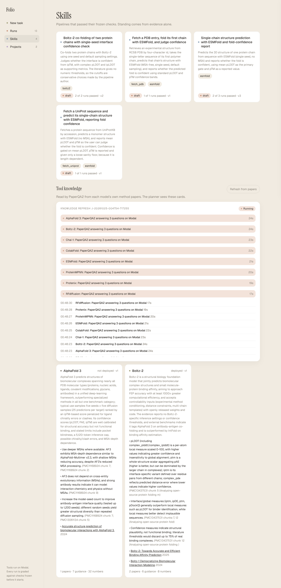
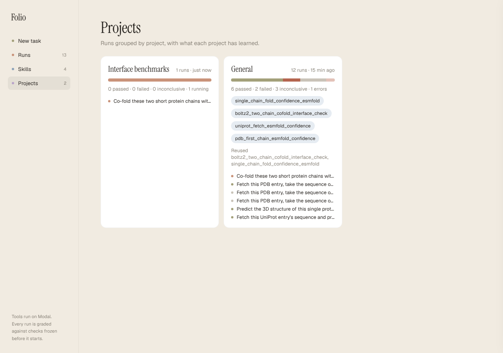
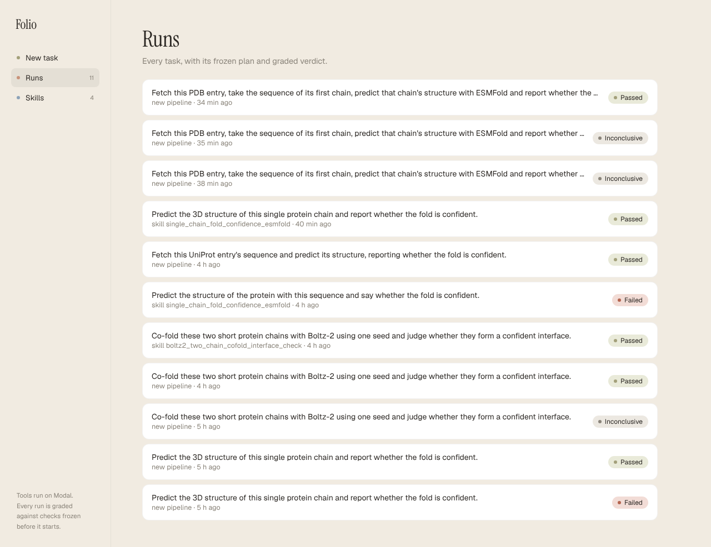
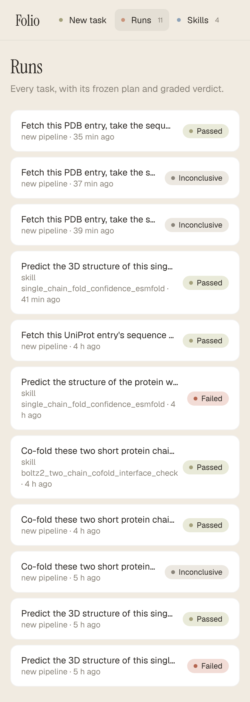

# labloop

## Overview

labloop turns scientific tasks into reusable skills. A task is a description, a set of named inputs and an optional project. For each task, labloop first asks whether a saved skill already covers it, and if one does, it runs that skill directly. Otherwise it reads the literature on the task, extracts the procedures and numbers the papers report, composes a pipeline from biomolecular tools deployed on Modal, freezes the pipeline together with its acceptance checks, runs it, and grades the outputs against those checks. A new pipeline that passes is saved as a skill, and every later use of a skill is added to its evidence.

Mubit has two jobs. By default every model call passes through the Mubit gateway, or another Anthropic-compatible endpoint, with one fixed system prompt per role, so the repeated calls of a role form one trainable task on the gateway. Mubit also stores the lessons of each run as memory, which later runs show to the planner as advisory context.

The backend exposes a JSON API, and the repository includes one frontend for it, Folio, a single static page that the backend serves at `/`. A deployment runs at https://persistentepiphany--labloop-backend-api.us-east.modal.run.


*The Folio home page with the "Fold a protein" template selected and its sequence input shown.*

## Loop

The orchestrator in `labloop/orchestrator.py` takes every task through seven phases in order. Each phase writes progress events to the run's `EVENTS.jsonl`, which is committed to the state Volume after every event, so the API and the frontend can show what is in flight and for how long.

### Match

The orchestrator recalls up to five lessons for the task and lists every saved skill that has not been retired. The applicability role decides whether one of these skills fits and maps the task's inputs onto that skill's input schema. Its answer is accepted only when it quotes one of the skill's `applies_when` conditions exactly, reports no `not_for` conflict, and maps every input the skill declares. Any other answer leads to a new plan. The decision and its reason are written to `match.json` and `DECISIONS.jsonl`, and every candidate skill gets a line in its consultation log saying whether it was invoked or declined.

### Research

When no skill fits, the researcher role writes Europe PMC queries, unless the task supplies its own `research_queries`. The `literature_corpus` Modal function runs the harness-experiments fetcher on them. It takes 25 Europe PMC results per query, ranks them by OpenAlex citation count, fetches full text from Europe PMC, as bioRxiv JATS or as an Unpaywall PDF, and freezes the corpus with the fetcher's manifest on the artifacts Volume. The `paperqa` Modal function then runs PaperQA2 over that corpus together with the `dsh-lab` seed corpus at `seed/dsh-lab-20260927T134914Z` on the artifacts Volume, and answers two fixed questions about the procedure and the reported numbers. The extractor role turns the cited answers into procedure steps, reported numbers and guidance, each with its source, for the planner. The result is written to `research/extractions.json`.

| Variable | Default | Effect |
| --- | --- | --- |
| `LABLOOP_RESEARCH_MAX_QUERIES` | 3 | Queries per run. |
| `LABLOOP_RESEARCH_PAGE_SIZE` | 25 | Europe PMC results per query. |
| `LABLOOP_RESEARCH_MAX_DOCS` | 8 | Papers kept in the corpus. |
| `LABLOOP_RESEARCH_EVIDENCE_K` | 10 | Evidence passages PaperQA2 uses per answer. |
| `LABLOOP_PAPERQA_LLM` | Sonnet 5.5 through `mubit` | PaperQA2's answering model. |
| `LABLOOP_PAPERQA_SUMMARY_LLM` | Haiku 5.5 through `mubit` | PaperQA2's summary model. |
| `LABLOOP_SEED_CORPORA` | `seed/dsh-lab-20260927T134914Z` | Comma-separated seed corpora read with every run's corpus. |

### Plan

The planner composes a pipeline from the catalog entries marked available, reading the research findings, the recalled lessons and the tool knowledge cards of the deployed tools. A step has the form `{"id", "tool", "args"}`, and an argument whose entire value is `$inputs.<name>`, `$run_id` or `$steps.<id>.<field>` is resolved when the step runs. With the steps, the planner declares the acceptance checks, an input schema, a skill description with `applies_when` and `not_for`, its sources, and each decision the literature left open. A plan that fails validation goes back to the planner once, with the errors attached.

### Freeze

Validation requires that every tool exists and is deployed, that every argument is known to its tool, that every reference resolves to a declared input or to an output of an earlier step, and that at least one check reads a real output. Before any step runs, the plan is written to `plan.json` and its SHA-256 digest to `plan.sha256`, computed over the canonical form used by ppi-harness. The run and grade phases reload the plan and refuse it if the digest no longer matches. Decisions the sources did not settle go to `DECISIONS.jsonl`.

### Run

Steps are grouped into waves of mutually independent steps. Each wave is dispatched with `modal.Function.from_name("labloop-tools", tool)`, using `.map()` for several calls of one tool and `.spawn()` for the rest, so the steps of a wave run concurrently. Each step is recorded in `EXPERIMENTS.jsonl`, and a step whose upstream value is missing is recorded as skipped.

### Grade

A check either compares a metric with a value (`op` and `value`) or matches a published reference (`reference`, `tolerance` and `source`). A check is UNVERIFIABLE when its metric is missing, is not numeric, or comes from a failed step. The verdict is FAIL when any check fails, INCONCLUSIVE when none fails and at least one is unverifiable, and PASS otherwise. As in ppi-harness, reading an INCONCLUSIVE verdict as a boolean raises an error, so it cannot be mistaken for a failure.

Domain graders also run in this phase. The ppi-assure grader applies only to Boltz-2 or Chai-1 steps with two or more chains, and only a BLOCKING failure it reports affects the verdict. The verdict is written once to `RESULTS.json`.

### Learn

The reviewer role reads the frozen plan, the step outcomes and the verdict, and writes short lessons, which are stored in memory. Each lesson recalled for the run receives an outcome of success or failure. An INCONCLUSIVE run records no outcome, because missing evidence is not negative evidence. A new pipeline that passes becomes a skill, and a reused skill receives the run as evidence whatever its verdict.

When `labloop/reporting.py` is present, the orchestrator then writes a short HTML report with figures for the run under `reports/<run_id>/` on the state Volume, and also uploads it to Supabase Storage when `SUPABASE_URL` and `SUPABASE_SERVICE_ROLE_KEY` are in the Modal secret. A failure while writing the report never fails the run.


*A completed run on PDB entry 1UBQ, whose planned `fetch_pdb` and `esmfold` pipeline passed all five frozen checks and was saved as a draft skill.*

## Skills

Each skill is stored at `skills/<name>/skill.json` under the state root, and every version is kept write-once under `skills/<name>/versions/`. A skill holds its name, title, description, `applies_when`, `not_for`, the pipeline with its checks, the input schema, lessons, sources and evidence. Each evidence entry records the run id, the task, the inputs digest, the verdict and the graded metrics. When the skill was reused through matching or a forced run, the entry also carries an `invocation` record of how it was chosen, the condition it matched and the input mapping.

A new skill records its `provenance`, which lists the run's queries, the papers retrieved and cited, the number of sourced numbers, the reference and threshold checks, the number of source-silent decisions, the tools whose knowledge cards were in view, and the lessons recalled. Every time a skill is considered for a run, a line is appended to `skills/<name>/consultations.jsonl`. That log sits outside the versioned skill file, because being considered is not evidence and must not change a skill's version or standing.

Standing is computed from the evidence each time a skill is read and is never stored. A skill is a draft after one passing run, and it is validated once it has also passed on inputs with a different digest. Only a person can retire a skill, through `python -m labloop.cli retire` or the `retire` entrypoint of the backend app, and retiring requires a name and a reason. No model output and no recalled memory can change standing.

The API presents each skill as a card with its name, title, description, tools, inputs, standing, number of runs, number of passes, number of invocations and version.


*The Skills page, with the saved skills above and the tool knowledge cards below, during a knowledge refresh whose progress is shown live.*


*The Boltz-2 co-folding skill, with its conditions, frozen pipeline and checks, evidence, lessons, and a form that runs it on new inputs.*

## Tool knowledge

Each catalogued model in `labloop/catalog.py` carries the DOIs of its method papers. Knowledge ingestion in `labloop/knowledge.py` fetches and freezes those papers with `literature_corpus`, has PaperQA2 answer three fixed questions about the model over them and the seed corpus, and has the extractor turn the cited answers into a card. A card covers the model's purpose and limits, how to read its confidence scores, its reported numbers and its recommended settings, each with a source. Cards are saved versioned under `knowledge/tools/` on the state Volume. Each sourced statement is also stored as a memory lesson, and the card is mirrored as a tool skill.

The planner reads the cards of deployed tools only. Cards are context for planning and change no frozen plan, grade or standing. An ingestion runs as a job under `jobs/` with its own `EVENTS.jsonl`, started by `POST /knowledge/refresh` or by `modal run modal_apps/backend_app.py::ingest`.

## Memory

Memory is context and never authority. Lessons are recalled once, before matching, and shown to the planner under the heading of advisory lessons. Grading and standing never read memory.

`MubitMemory` uses the explicit `mubit.Client` from `mubit-sdk` 0.13.2 with `remember`, `get_context`, `record_outcome` and `create_skill`, and it also writes every lesson to a local JSONL copy. `LocalMemory` implements the same interface on JSONL files. The tests use it, and so do runs with `LABLOOP_MEMORY=local` and runs with no key set. The literature corpus stays on the artifacts Volume and is never stored in Mubit.

## Models

Every call uses the Anthropic Messages format through the `anthropic` SDK and is streamed, so a reasoning model has room to finish its answer. Each role has one fixed system prompt in `labloop/prompts.py`, and all task-specific content, the catalog included, goes in the user message. Calls through the gateway carry the run id as `metadata.user_id`, which the gateway uses as its session key.

| Role | Default | Purpose |
| --- | --- | --- |
| planner | Anthropic Opus 5 at high effort through `mubit` | Composes the pipeline and its checks. |
| researcher | Anthropic Haiku 5.5 through `mubit` | Writes literature queries. |
| extractor | Anthropic Haiku 5.5 through `mubit` | Turns cited answers into sourced procedure, numbers and guidance. |
| applicability | Anthropic Haiku 5.5 through `mubit` | Decides whether a saved skill fits. |
| reviewer | Anthropic Opus 5 at high effort through `mubit` | Writes lessons after grading. |

The exact model ids are in `ROLE_DEFAULTS` in `labloop/models.py`. A role is reassigned with `LABLOOP_MODEL_<ROLE>`, written as `provider:model` or `provider:model@effort`, and the effort is sent as `output_config.effort`. On Modal these overrides live in the secret `labloop-routing`. That secret currently routes every role and PaperQA2 to GLM 5.3 on Z.AI, because the Anthropic account behind the Mubit provider key has reached its monthly usage limit until 2026-11-01. Deleting the overrides from the secret restores Opus 5 and Haiku 5.5 through Mubit.

| Provider | Base URL | Key |
| --- | --- | --- |
| `mubit` | `https://api.mubit.ai/anthropic` | `MUBIT_API_KEY` or `MUBIT_API_TOKEN` |
| `zai` | `https://api.z.ai/api/anthropic` | `ZAI_API_KEY` |
| `moonshot` | `https://api.moonshot.ai/anthropic` | `MOONSHOT_API_KEY` |

Recording on the gateway follows `LABLOOP_MUBIT_RECORD` (default `full`) and `LABLOOP_MUBIT_STORE` (default `true`). Z.AI model ids that carry a bracket suffix are refused. The gateway does not forward to Z.AI, so a role moved to `zai` is not recorded there. Calls to Opus 5, Opus 5.5, Sonnet 5.5 and Fable 5.1 enable the server-side refusal fallback, so a request that one model declines is retried on another and the run continues.

`python -m labloop.cli probe` makes one short call to every provider and model the roles use, and to Kimi when `MOONSHOT_API_KEY` is set. The Kimi model comes from `LABLOOP_KIMI_MODEL` and defaults to `kimi-k3[1m]`.

## Tools

`labloop-tools` has one Modal function per available catalog entry. Each function takes one dict of arguments, writes its outputs under `<run_id>/<step_id>/` on the `labloop-artifacts` Volume, commits the Volume, and returns scores, artifact paths relative to that Volume, small data, the runtime and the versions used.

| Tool | GPU | Image and weights |
| --- | --- | --- |
| `esmfold` | A10G | `transformers` 4.46.3 with `facebook/esmfold_v1`, cached on `labloop-weights-esmfold`. Inference runs with `HF_HUB_OFFLINE=1`. |
| `boltz2` | H100 | `boltz==2.1.1` with torch pinned to 2.7.1 and `boltz-community/boltz-2` at revision `6fdef46d`, on `labloop-weights-boltz`, run with `--no_kernels`. |
| `chai1` | H100 | `chai_lab==0.5.0` with torch 2.7.1 for CUDA 12.8 and `CHAI_DOWNLOADS_DIR` on `labloop-weights-chai`, run as in Modal's published example. |
| `fetch_uniprot` | none | UniProtKB FASTA. |
| `fetch_pdb` | none | RCSB PDB entry, with chain sequences read from the coordinates. |
| `literature_search` | none | Europe PMC search with abstracts and optional open-access full-text excerpts. |
| `literature_corpus` | none | The harness-experiments fetcher, which builds and freezes a corpus on the artifacts Volume. |
| `paperqa` | none | PaperQA2 over one or more frozen corpora, with model calls in the Anthropic format through a named provider and a local sentence-transformers embedding cached on `labloop-weights-paperqa`. |

ColabFold, ProteinMPNN, RFdiffusion, DiffDock, Protenix and AlphaFold 3 are catalogued as unavailable, so the planner never sees them. Each becomes available once its function is built and verified.

Boltz 2.1.1 leaves torch unpinned. Unpinned, torch resolves to a CUDA 13 build whose NVRTC builtins are absent from the image, and the first reduction kernel then fails to compile, which is why the image pins torch. With torch 2.7.1 the cuEquivariance kernels that Boltz installs do not import, so predictions run without them. At these sizes that makes predictions slower and leaves their accuracy unchanged.

The download functions fill the weight Volumes once. `download_chai` also folds one short chain after fetching the listed files, so any file that Chai-1 fetches lazily lands on the Volume instead of being fetched during a request.

## Layout

| Path | Content |
| --- | --- |
| `labloop/orchestrator.py` | The loop of match, research, plan, freeze, run, grade and learn. |
| `labloop/catalog.py` | The tool catalog with each model's method papers. Planning chooses only from entries marked available. |
| `labloop/pipeline.py` | Pipeline validation, reference resolution, scheduling in waves, and the freeze. |
| `labloop/grading.py` | Check evaluation and the three-state verdict. |
| `labloop/graders/ppi.py` | The optional ppi-assure grader for protein-protein co-folding outputs. |
| `labloop/skills.py` | The versioned skill store, the consultation log and the standing rules. |
| `labloop/knowledge.py` | Tool knowledge ingestion and the versioned card store. |
| `labloop/events.py` | The per-run and per-job progress log. |
| `labloop/bundle.py` | Everything recorded about one run as one document, for the API and the report. |
| `labloop/memory.py` | Local JSONL memory and the Mubit memory client. |
| `labloop/models.py`, `labloop/prompts.py` | Role routing across providers and the fixed system prompts. |
| `labloop/research.py` | The research step. |
| `labloop/toolkit/` | Tool bodies shared by Modal and local runs, the corpus and PaperQA2 helpers, and readers for Boltz, Chai and ESMFold outputs. |
| `labloop/lit/fetch_corpus.py` | The keyless literature fetcher, vendored unchanged from harness-experiments. |
| `labloop/template/` | The run state layout from harness-experiments. |
| `labloop/api.py` | The FastAPI application. |
| `labloop/web/index.html` | The Folio frontend. |
| `modal_apps/tools_app.py` | The `labloop-tools` Modal app. |
| `modal_apps/backend_app.py` | The `labloop-backend` Modal app, which serves the API, the orchestrator and knowledge ingestion. |
| `scripts/real_runs.sh` | The sequence of small real requests. |
| `tests/` | Offline tests that run the whole loop with a fake dispatcher and scripted model answers. |

## Deployment

```bash
modal secret create labloop-keys MUBIT_API_KEY=... ZAI_API_KEY=...
modal deploy modal_apps/tools_app.py
modal run modal_apps/tools_app.py::download_all
modal run modal_apps/tools_app.py::smoke
modal deploy modal_apps/backend_app.py
modal run modal_apps/backend_app.py::ingest
```

The backend also reads the Modal secret `labloop-routing` for per-role model overrides. A redeploy did not always replace containers that were already warm, so a function could keep serving the previous code. Stopping the app before deploying it again (`modal app stop -y labloop-tools`) makes the next call run the new code. Nothing is lost by stopping, because state and weights live on Volumes.

`MOONSHOT_API_KEY` and `MUBIT_PROJECT_ID` may be added to `labloop-keys`, and `MUBIT_PROJECT_ID` enables the skill mirror. `SUPABASE_URL` and `SUPABASE_SERVICE_ROLE_KEY` enable report upload. Deploying the backend with `PPI_HARNESS_PATH` pointing at a ppi-harness checkout ships ppi-assure into the image for the domain grader.

| Method and path | Effect |
| --- | --- |
| `GET /` | Serves the Folio frontend. |
| `POST /tasks` | Accepts `{"description", "inputs", "project"?, "research_queries"?}`, spawns the orchestrator, and returns the run id. |
| `GET /runs` | Lists recent runs with their phase, verdict, origin, skill and latest activity. |
| `GET /runs/{id}` | Returns the run status, task, match decision, frozen plan and digest, inputs, experiments, decisions, research, results and events. |
| `GET /runs/{id}/report` | Returns the run's HTML report, with its figures under `/runs/{id}/report/figures/`. |
| `GET /artifacts/{path}` | Returns a `.pdb`, `.cif`, `.json`, `.png`, `.txt` or `.pdf` file from the artifacts Volume. |
| `GET /projects` | Groups runs by project with verdict counts, skills created and used, and recent runs. |
| `GET /skills` | Returns skill cards. Retired skills appear with `include_retired=true`. |
| `GET /skills/{name}` | Returns the card, the full skill and its consultation log. |
| `POST /skills/{name}/run` | Accepts `{"inputs", "description"?}` and runs that skill without matching or planning. |
| `GET /knowledge` | Returns the tool knowledge cards. |
| `POST /knowledge/refresh` | Starts a knowledge ingestion job and returns its job id. |
| `GET /jobs` | Lists recent jobs with their latest activity. |
| `GET /jobs/{id}` | Returns one job with its events. |

State lives on the `labloop-state` Volume. The orchestrator, the ingestion job and the `retire` function are its only writers, each in at most one container, and the orchestrator commits after every phase, every wave and every event. The API reloads the Volume before every read and never writes to it. Submitted runs are recorded in the Modal Dict `labloop-calls`, so a run that has not started yet reads as queued, and a run whose orchestrator call failed before writing state reads as an error. Workers write only to `labloop-artifacts`, and the orchestrator reloads that Volume before grading.

## Frontend

Folio, in `labloop/web/index.html`, is built from the Folio design and uses no build step and no framework. It submits a free-text task or one of three templates, which fold a protein with ESMFold, co-fold two chains with Boltz-2, or fetch a UniProt entry and fold it. It follows a run through its seven phases with a live activity feed, and shows the frozen checks with their observed values, a chart of the metrics, the step outputs, a 3D view of predicted structures with preset angles, the distilled findings of the study, the frozen papers, the reviewer's summary and lessons, and any skill the run saved or used. Papers open in a reader drawer that shows the PDF or the frozen full text and can be expanded. Skill pages show invocations and what the research extracted, and a Projects page groups runs by project. The 3D view loads 3Dmol.js from jsDelivr.


*The Projects page, with runs grouped by project, their verdict counts, and the skills each project created or reused.*


*The Runs list, with each task's origin, either a new pipeline or a named skill, and its verdict.*



*The same list at a width of 390 pixels, where the sidebar becomes a top bar.*

## Local use

```bash
pip install -e '.[mubit,dev]'
python -m pytest
python -m labloop.cli probe
python -m labloop.cli run --dispatcher local --description "..." --inputs '{"sequence": "..."}'
```

The local dispatcher runs only the CPU data tools in process. A local run therefore plans and freezes a real pipeline, reports its model steps as failed, and grades as INCONCLUSIVE. `--dispatcher modal` calls the deployed tools. `scripts/real_runs.sh` deploys the tools, fetches the weights and runs the smoke fold, then runs an ESMFold task, a two-chain Boltz-2 task, and the same Boltz-2 task again to confirm that the skill is reused.

## Prior work

The run state layout comes from `template/` of harness-experiments, and the literature fetcher from `lit/fetch_corpus.py` on its `exp2-sep/arm-a` branch. A skill is the persistent counterpart, backed by evidence, of the frozen `WORKFLOW.md` that Arm B writes in that experiment. The canonical digest, the write-once results, and the refusal to read an uninformative outcome as a boolean follow `harness/canonical.py` and `harness/results.py` of ppi-harness. The ppi-assure grader calls `ppi_assure.core.run.audit` on co-folding output directories.

The episode runner `runner.py` is not used, because the loop composes catalogued functions and runs no code written by a model. A later step that does run such code should run it in a Modal Sandbox.

## Verification

The offline tests cover a first task that researches, plans, freezes, runs, grades and saves a skill, and a second task that reuses the skill without planning. They also cover rejected applicability answers, failing and unverifiable checks, the planner retry, a tampered plan, forced skill runs, retirement, and the API.

On Modal, the ESMFold smoke fold of 30 residues returned mean pLDDT 89.7 in 20 seconds of GPU time. A Boltz-2 prediction of two 22-residue chains returned ipTM 0.88 in 44 seconds. The Chai-1 download folded one short chain on an H100 as its warmup.

Through the deployed API, the first ESMFold task failed its frozen check `ptm >= 0.5` with pTM 0.494, and its reviewer recorded that the threshold was too strict for a 30-residue chain. The same task, submitted again, was planned with that lesson in view, froze a pTM floor of 0.3, passed, and was saved as a skill. A two-chain Boltz-2 task passed four checks and was saved as a skill, with ppi-assure reporting no blocking finding, and the identical task submitted again reused the skill without planning and passed. A UniProt task fetched hemoglobin alpha on Modal and folded it with pLDDT 94.7. An ESMFold task on crambin reused the ESMFold skill and failed its check with pLDDT 43.7, and that failure stands as evidence on the skill. These runs used the earlier research step, which searched Europe PMC directly and read abstracts.

Against the real services, the gateway served the Sonnet 5.5 and Haiku 5.5 models, and Z.AI served `glm-5.3`. Europe PMC, UniProt and RCSB answered requests from the local data tools. One live planning run produced a valid ESMFold pipeline and another a valid two-chain Boltz-2 pipeline, both frozen with checks. The live applicability role reused a seeded monomer skill for a single-chain task, quoting its condition exactly, and refused it for a heterodimer because of its `not_for` clause.

## Limitations

The Anthropic account behind the Mubit provider key has reached its monthly usage limit, which lasts until 2026-11-01. Every role and PaperQA2 therefore run on GLM 5.3 through Z.AI, so current runs are neither recorded on the Mubit gateway nor planned by Opus 5.

The Mubit memory and skills API is not reachable with this key, even from Modal. The SDK's HTTP routes reach the gateway at `api.mubit.ai`, which answers `unknown_route` for memory paths, and its gRPC transport returns an authentication error. Memory therefore falls back to the local JSONL copy on the state Volume, which recalls by word overlap and not by semantic similarity. Skills and the tool skill mirrors of knowledge cards stay on the state Volume, and matching reads skills from there. After the first such error, the client stops calling the remote API for the rest of the process.

Supabase is not configured, because `SUPABASE_URL` and `SUPABASE_SERVICE_ROLE_KEY` are not yet in the Modal secret. Reports are therefore stored only on the state Volume.

The orchestrator runs in one container at a time. Two runs therefore never write the skill store at once, and concurrent tasks wait in a queue.

No run has called Chai-1 through the loop, because no planner has yet chosen it. Its weights and warmup fold are verified, so the function works on its own, but its behavior inside a pipeline is untested.

Kimi has not been checked. No Moonshot key was available, and the gateway exposes OpenRouter only through its OpenAI-format compatibility path, which the Anthropic-only call convention excludes.

The deployed endpoint has no authentication. Anyone who has the address can start runs that spend GPU time and model credit.
