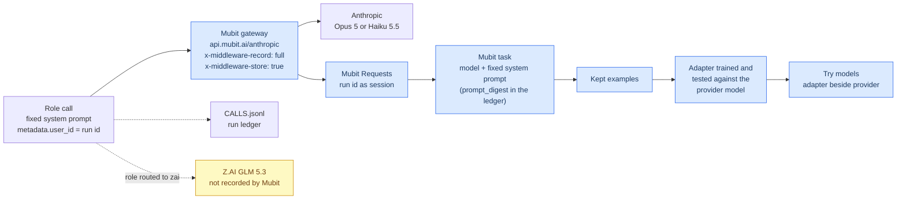
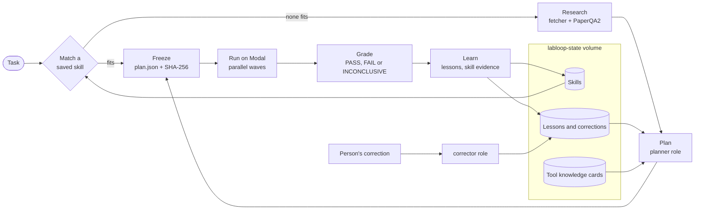

# labloop

labloop turns computational biology tasks into graded, reusable skills. A task either reuses a saved skill or is researched, planned, frozen and run as a pipeline of GPU tools on Modal; a passing pipeline becomes a skill. Six model roles do the reasoning, each with one fixed system prompt, so each role is one recurring task on Mubit that is recorded, corrected and trained into an adapted model.

Live at **https://persistentepiphany--labloop-backend-api.us-east.modal.run** (API and the Folio frontend).


## The brief, and where it shows

| Criterion | What answers it | Where to see it | Status |
| --- | --- | --- | --- |
| Recurring tasks, corrections becoming model updates | Six fixed-prompt roles, each recorded as one Mubit task. The corrector role and `POST /runs/{id}/corrections` turn a correction into a rule; "Re-run with this correction" plans again under it. | Run page, Learning page, Mubit Requests | Built; awaits live corrections |
| Own your intelligence layer | `labloop-routing` moves any role between a closed model (Opus 5 or Haiku 5.5 through Mubit) and an open one (GLM 5.3 through Z.AI). Each call is logged to the run's `CALLS.jsonl` with provider, model, latency, tokens, cost, `recorded_by_mubit` and `prompt_digest`. | Learning page, closed against open per role | Open side has data; closed side refills after the Anthropic limit resets |
| Fast refresh | Refresh jobs rebuild versioned tool cards from new papers. Skill versions and lessons grow with every run, and every recorded call is a new example for the next adapter version. | Skills page, Learning refresh panel, `GET /jobs` | Cards and skills verified; adapter retraining awaits new examples |
| Use of Mubit | Every role call is recorded through the Mubit gateway. A correction yields a recorded corrector call and a recorded corrected planner call, which train the next adapter of each task. | [How Mubit is used](#how-mubit-is-used) | Gateway verified; memory API refused for this key |

## How Mubit is used



Mubit groups calls into a task by model and system prompt. labloop keeps each prompt in `labloop/prompts.py` fixed and puts the task, inputs, catalog and lessons in the user message, so all calls of a role share one task. The ledger's `prompt_digest` (12 hex digits of the prompt's SHA-256) names that task; editing a prompt starts a new one.

| Role | Purpose | Default through Mubit | Why it repeats |
| --- | --- | --- | --- |
| planner | Pipeline, acceptance checks, skill description | Opus 5 at high effort | Every new task, one output schema |
| researcher | Europe PMC queries | Haiku 5.5 | Every researched task |
| extractor | Sourced procedure, numbers and guidance from PaperQA2 answers | Haiku 5.5 | Every run and every tool card |
| applicability | Whether a saved skill fits, and the input mapping | Haiku 5.5 | Every task |
| reviewer | Lessons after grading | Opus 5 at high effort | Every finished run |
| corrector | A person's correction as one reusable rule | Haiku 5.5 | Every correction |

### A correction becoming a model update

1. A person writes a correction in the "Correct this run" card of a finished run (`POST /runs/{id}/corrections`).
2. The corrector role, a recorded Mubit task, turns it into a rule that names the tool, argument or check and the value to use.
3. The rule is stored as a correction lesson. Recall ranks it above lessons the system wrote, and the planner receives it under its own heading with an instruction to follow it.
4. "Re-run with this correction" resubmits the task with `replan: true` and `corrects: <run id>`, so no saved skill is reused and the planner plans afresh with the rule.
5. The new plan is frozen and graded. The Learning page shows the correction, the follow-up run and the change in steps and checks.
6. The corrector call and the corrected planner call are recorded examples of their Mubit tasks, and the next adapter version of each trains on them.

### Memory and skills through the SDK

`MubitMemory` (`labloop/memory.py`) uses `mubit.Client` from `mubit-sdk` 0.13.2. It calls `remember` per lesson with the run id as session, `get_context` before matching, `record_outcome` for each recalled lesson, and `create_skill` to mirror skills and tool cards when `MUBIT_PROJECT_ID` is set. This key is refused by that API, so runs read the local JSONL copy kept beside it (see [Limitations](#limitations)).

## Architecture



| Modal app | Functions | Storage |
| --- | --- | --- |
| `labloop-backend` | `api` (FastAPI and Folio), `orchestrate` (one container), `correct_run`, `ingest_knowledge`, `backfill_reports`, `retire_skill` | `labloop-state` volume, Modal Dict `labloop-calls` |
| `labloop-tools` | `esmfold` (A10G), `boltz2` (H100), `chai1` (H100), `fetch_pdb`, `fetch_uniprot`, `literature_search`, `literature_corpus`, `paperqa` | `labloop-artifacts` volume, one `labloop-weights-*` volume per model |

The run and grade phases recheck the frozen plan's digest and refuse a changed plan. A missing metric makes the verdict INCONCLUSIVE, which records no lesson outcome.

## Research and tool knowledge

| Part | What it does |
| --- | --- |
| Harness fetcher | `literature_corpus` ranks Europe PMC hits by OpenAlex citations, fetches full text and freezes the corpus. |
| PaperQA2 | Answers fixed questions on procedure and reported numbers over the corpus and the `dsh-lab` seed corpus, with citations. |
| Extractor | Keeps only what the evidence states, each item with its source. |
| Model-paper cards | A refresh job reads each model's method papers into a versioned card (limits, score reading, reported numbers, settings) that the planner reads. |

## Skills

| Rule | Detail |
| --- | --- |
| Standing | Draft after one pass, validated after a pass on different inputs. Computed from evidence, never stored. |
| Retirement | Only a person can retire a skill, with a reason. No model output changes standing. |
| Invocation tracking | `consultations.jsonl` records each time a skill is invoked or declined. Reuse stores the matched condition and input mapping with the evidence. |
| Provenance | Queries, papers cited, sourced numbers, source-silent decisions, tool cards and lessons in view. |

## Frontend

Folio (`labloop/web/index.html`) is one static page served at `/`. It follows runs live and shows checks against observed values, 3D structures, studies and papers read, and skills with their evidence. The Learning page (`#/learning`) and the "Correct this run" card are new; screenshots of them will follow.

<table>
  <tr>
    <td><br>New task, templates and saved skills</td>
    <td><br>A skill with conditions, checks, evidence and lessons</td>
  </tr>
  <tr>
    <td><br>1UBQ, experimental beside the ESMFold prediction</td>
    <td><br>Boltz-2 co-fold, colored by chain</td>
  </tr>
</table>

## Reports

Each finished run has an HTML report at `GET /runs/{id}/report` with the outcome, how the pipeline was chosen, metrics against thresholds, structure views, the study distillation and a timeline.


## API

| Method and path | Effect |
| --- | --- |
| `POST /tasks` | Submit `{description, inputs, project?, research_queries?, replan?, corrects?}` |
| `GET /runs`, `GET /runs/{id}` | List runs, or one run in full |
| `POST /runs/{id}/corrections` | Submit `{text, by?}` for the corrector |
| `GET /runs/{id}/report` | HTML report |
| `GET /learning` | Corrections, fail then pass pairs, per-role model comparison, refresh history |
| `GET /skills`, `GET /skills/{name}`, `POST /skills/{name}/run` | Skill cards, one skill, run a skill directly |
| `GET /knowledge`, `POST /knowledge/refresh` | Tool cards, start a refresh job |
| `GET /jobs`, `GET /jobs/{id}`, `GET /projects`, `GET /artifacts/{path}` | Jobs, projects, output files |

## Deployment

```bash
modal secret create labloop-keys MUBIT_API_KEY=... ZAI_API_KEY=...     # optional MUBIT_PROJECT_ID, SUPABASE_URL, SUPABASE_SERVICE_ROLE_KEY
modal secret create labloop-routing LABLOOP_MODEL_PLANNER=zai:glm-5.3  # provider:model[@effort] per role; a role left out keeps its Mubit default
modal deploy modal_apps/tools_app.py && modal run modal_apps/tools_app.py::download_all
modal deploy modal_apps/backend_app.py && modal run modal_apps/backend_app.py::ingest
```

Stop an app (`modal app stop -y labloop-tools`) before redeploying, because warm containers can keep old code. State and weights live on volumes.

## Local use

```bash
pip install -e '.[mubit,reports,dev]'
python -m pytest
python -m labloop.cli probe
python -m labloop.cli run --dispatcher local --description "..." --inputs '{"sequence": "..."}'
```

The local dispatcher runs only CPU data tools, so a local run plans and freezes a real pipeline and grades INCONCLUSIVE. `--dispatcher modal` uses the deployed tools.

## Status

Verified live on Modal and through the deployed API.

| Run | Result |
| --- | --- |
| ESMFold smoke, 30 residues | pLDDT 89.7 |
| Boltz-2, two 22-residue chains | ipTM 0.88 in 44 s |
| First ESMFold task | FAIL, pTM 0.494 against a frozen floor of 0.5 |
| Same task again | Used that lesson, froze pTM >= 0.3, passed, became a skill |
| Boltz-2 task | PASS on 4 checks; the identical task then reused the skill |
| 1UBQ via `fetch_pdb` and ESMFold | pLDDT 90.5, pTM 0.83, PASS |
| Harness research on a Chai-1 task | 63 papers found, 8 frozen in full text, PaperQA2 read 18 and cited 7, 30 sourced numbers |

Built and awaiting data. The call ledger, the Learning page and the correction flow are in place. Runs older than the ledger have no `CALLS.jsonl`, and the closed-model column stays empty while every role routes to GLM 5.3. Adapter training needs new recorded examples, which resume once roles route through the gateway again.

## Limitations

- The Anthropic account behind the Mubit provider key hit its usage limit until 2026-11-01, so `labloop-routing` sends every role and PaperQA2 to GLM 5.3 on Z.AI. Mubit does not record those calls, so current runs add no examples to the Mubit tasks.
- The Mubit memory and skills API is unreachable with this key, even from Modal (HTTP `unknown_route`, gRPC authentication error). Lessons and skill mirrors therefore stay on the state volume, and recall uses word overlap instead of semantic search.
- Supabase is not configured (`SUPABASE_URL`, `SUPABASE_SERVICE_ROLE_KEY`), so reports live only on the state volume.
- One orchestrator container runs at a time, so concurrent tasks queue.
- The endpoint has no authentication, so anyone with the address can spend GPU time and model credit.
- Kimi is unchecked because no Moonshot key was available.
