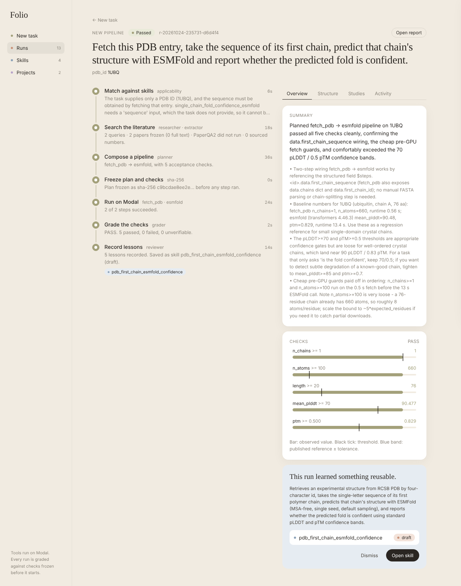
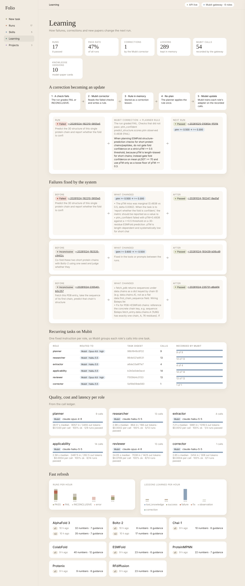
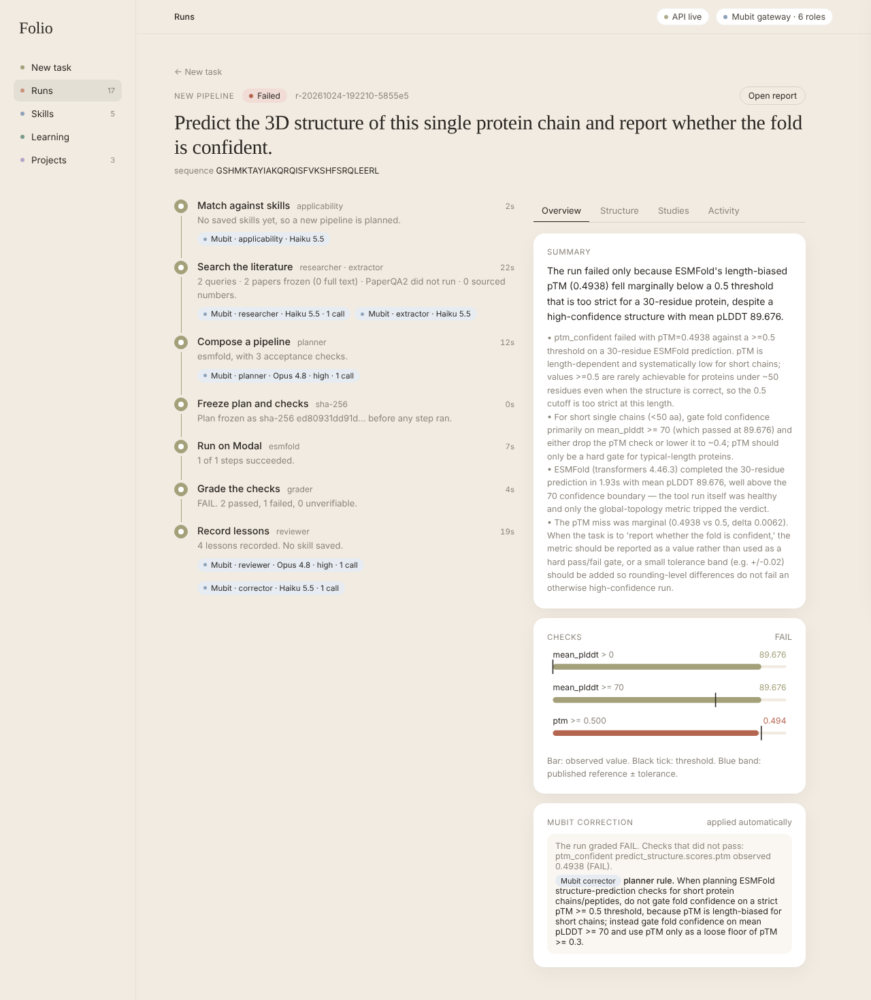
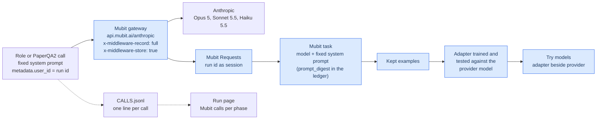
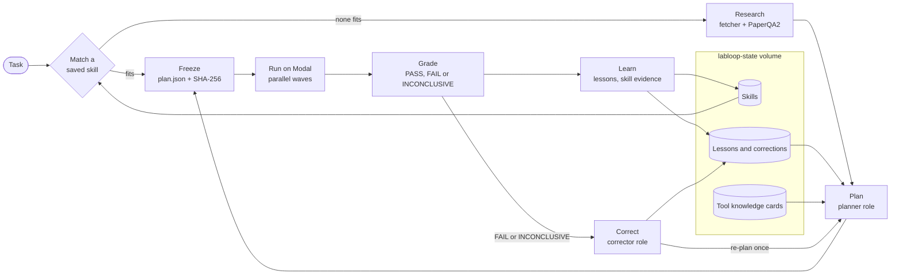
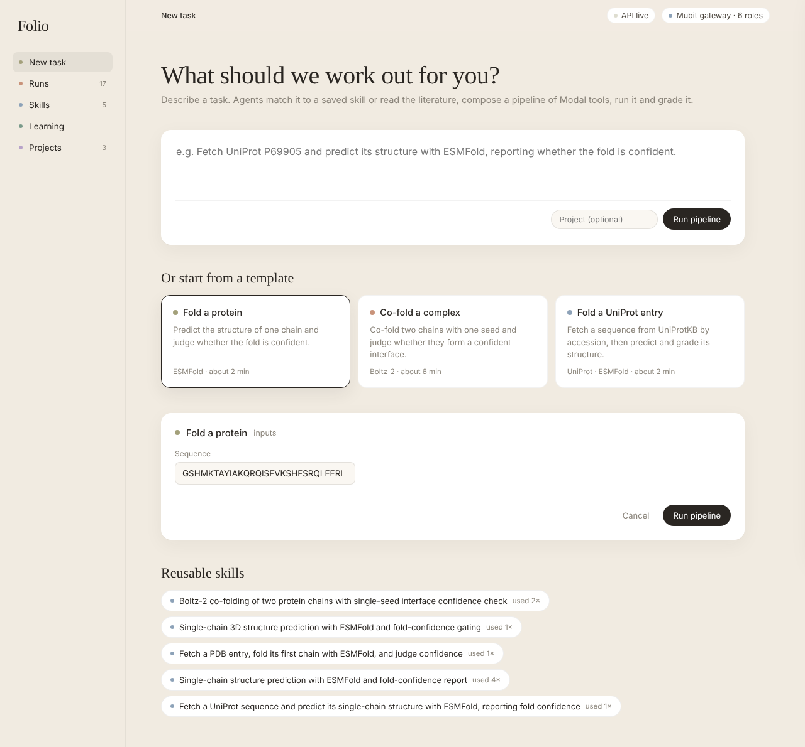
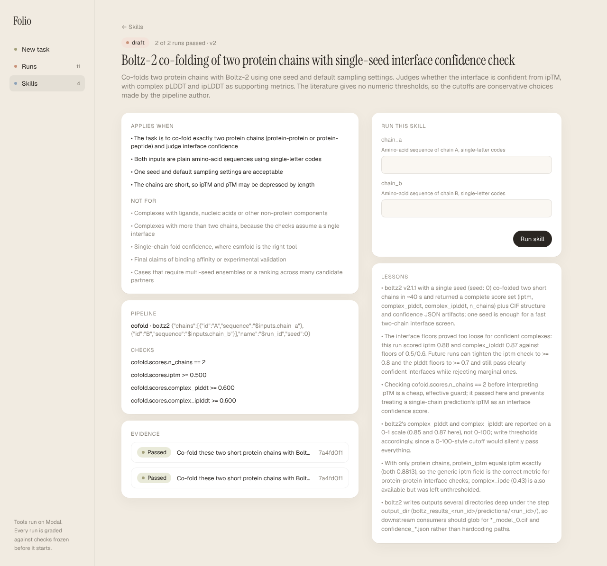
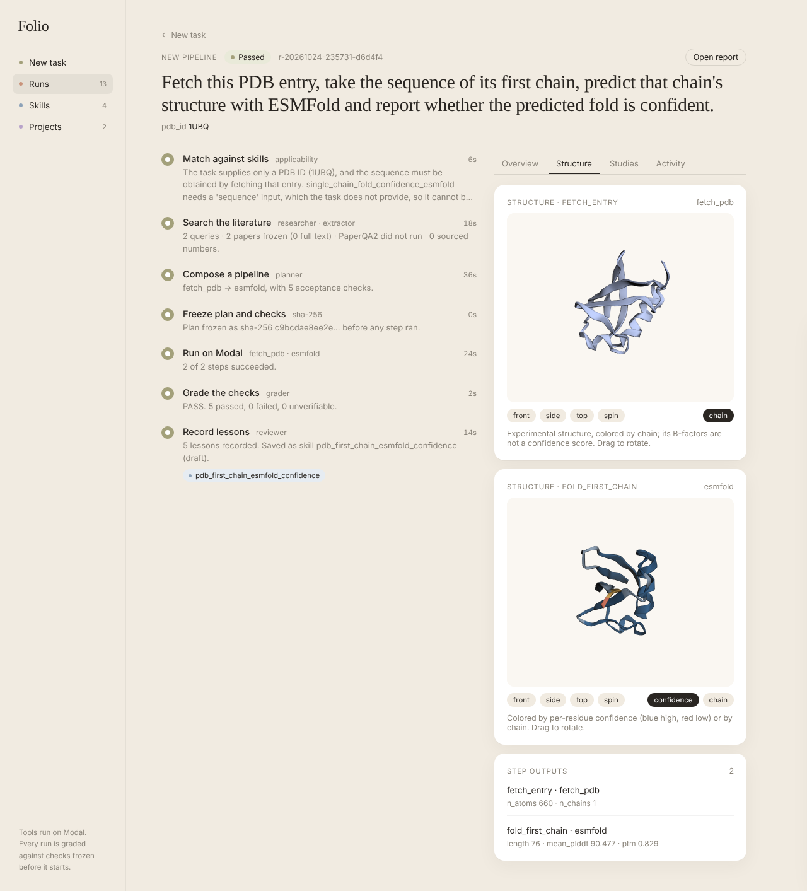
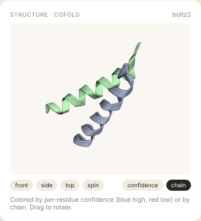
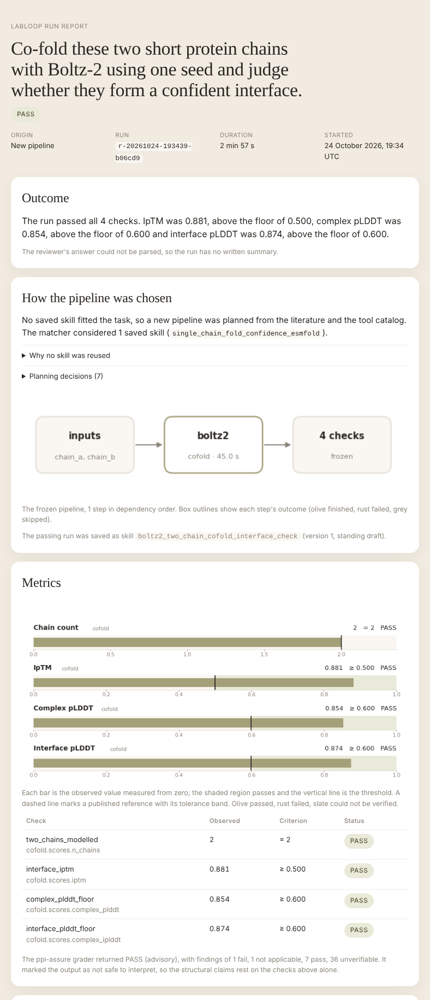

# labloop

labloop turns computational biology tasks into graded, reusable skills. A task reuses a saved skill or is researched, planned, frozen and run as a pipeline of GPU tools on Modal. A passing pipeline becomes a skill. Six model roles do the reasoning, each with one fixed system prompt, so each role is one recurring Mubit task that is recorded, corrected and trained into an adapter.

Live at **https://persistentepiphany--labloop-backend-api.us-east.modal.run** (API and the Folio frontend).



## The brief, and where it shows

| Criterion | What answers it | Where to see it | Status |
| --- | --- | --- | --- |
| Recurring tasks, corrections becoming model updates | Six fixed-prompt roles, each one Mubit task. When a run fails or is inconclusive, the corrector role writes a rule and the orchestrator re-plans the task once under it. | Run page, Learning page, Mubit Requests | Verified on a failed ESMFold run, whose correction became a planner rule and a re-run |
| Own your intelligence layer | Every role runs on Anthropic models through Mubit. The call ledger (`CALLS.jsonl` per run, with role, model, latency, tokens, list-price cost and `prompt_digest`) gives per-role quality, cost and latency for each model. Adapters Mubit trains from the recorded calls are compared with the provider model in Mubit's Try models. | Learning page, run page, Mubit console | Ledger live; adapters are compared in the Mubit console, not in this app |
| Fast refresh | Refresh jobs rebuild versioned tool cards from new papers. Skills and lessons grow with each run, and each recorded call is a training example for the next adapter. | Skills page, Learning refresh panel, `GET /jobs` | Cards and skills verified; adapter retraining awaits examples |
| Use of Mubit | Every model call goes through the Mubit gateway and is recorded, PaperQA2's included. The run page shows each phase's Mubit calls as they happen. | [How Mubit is used](#how-mubit-is-used) | Gateway verified; `api.mubit.ai` does not serve the SDK memory routes |

<table><tr>
<td width="50%"><br><sub>Learning page from live state.</sub></td>
<td width="50%"><br><sub>A failed run and the rule its correction became.</sub></td>
</tr></table>

## How Mubit is used



Mubit groups calls into a task by model and system prompt. Each prompt in `labloop/prompts.py` stays fixed, and the task, inputs, catalog and lessons go in the user message, so all calls of a role share one task. The ledger's `prompt_digest` (12 hex digits of the prompt's SHA-256) names that task. Editing a prompt starts a new one.

| Role | Purpose | Default through Mubit | Why it repeats |
| --- | --- | --- | --- |
| planner | Pipeline, acceptance checks, skill description | Opus 5 at high effort | Every new task, one output schema |
| researcher | Europe PMC queries | Haiku 5.5 | Every researched task |
| extractor | Sourced procedure, numbers and guidance from PaperQA2 answers | Haiku 5.5 | Every run and every tool card |
| applicability | Whether a saved skill fits, and the input mapping | Haiku 5.5 | Every task |
| reviewer | Lessons after grading | Opus 5 at high effort | Every finished run |
| corrector | One rule from a failed run's checks and lessons | Haiku 5.5 | Every failed or inconclusive run |

PaperQA2 also calls Mubit, through LiteLLM, with Sonnet 5.5 for answers and Haiku 5.5 for summaries. The `labloop-routing` Modal secret can override a role's model with `LABLOOP_MODEL_<ROLE>`.

### A correction becoming a model update

1. A planned run ends FAIL or INCONCLUSIVE.
2. The corrector role, a recorded Mubit task, reads the failed checks and the reviewer's lessons and writes one rule that names the tool, argument or check and the value to use. No person writes or edits it.
3. The rule is stored as a correction lesson. Recall ranks it above other lessons, and the planner gets it under its own heading with an instruction to follow it.
4. The orchestrator re-plans the task once under the rule and reuses no saved skill.
5. The new plan is frozen, run and graded. The Learning page shows each Mubit correction, the re-run it produced and the check that changed.
6. The corrector call and the corrected planner call are recorded examples of their Mubit tasks, so the next adapter of each trains on them.

### Memory and skills through the SDK

`MubitMemory` (`labloop/memory.py`) uses `mubit.Client` from `mubit-sdk` 0.13.2. It calls `remember` per lesson with the run id as session, `get_context` before matching, `record_outcome` per recalled lesson, and `create_skill` to mirror skills and tool cards when `MUBIT_PROJECT_ID` is set. `api.mubit.ai` does not serve these routes, so runs read the local JSONL copy (see [Limitations](#limitations)).

## Architecture



| Modal app | Functions | Storage |
| --- | --- | --- |
| `labloop-backend` | `api` (FastAPI and Folio), `orchestrate` (one container), `correct_run`, `ingest_knowledge`, `backfill_reports`, `retire_skill` | `labloop-state` volume, Modal Dict `labloop-calls` |
| `labloop-tools` | `esmfold` (A10G), `boltz2` (H100), `chai1` (H100), `fetch_pdb`, `fetch_uniprot`, `literature_search`, `literature_corpus`, `paperqa` | `labloop-artifacts` volume, one `labloop-weights-*` volume per model |

The run and grade phases recheck the frozen plan's digest and refuse a changed plan. A missing metric makes the verdict INCONCLUSIVE, which records no lesson outcome and starts a correction.

## Research and tool knowledge

| Part | What it does |
| --- | --- |
| Harness fetcher | `literature_corpus` ranks Europe PMC hits by OpenAlex citations, fetches full text and freezes the corpus. |
| PaperQA2 | Answers fixed questions on procedure and reported numbers, with citations, over the corpus and the `dsh-lab` seed corpus. |
| Extractor | Keeps only what the evidence states, each item with its source. |
| Model-paper cards | A refresh job reads each model's method papers into a versioned card (limits, score reading, reported numbers, settings) for the planner. |

## Skills

| Rule | Detail |
| --- | --- |
| Standing | Draft after one pass, validated after a pass on different inputs. Computed from evidence and kept in the API and skill files; Folio does not show it. |
| Retirement | Only a person retires a skill, with a reason. No model output changes standing. |
| Invocation tracking | `consultations.jsonl` records each time a skill is invoked or declined. Reuse stores the matched condition and input mapping with the evidence. |
| Provenance | Queries, cited papers, sourced numbers, source-silent decisions, tool cards and lessons in view. |

## Frontend

Folio (`labloop/web/index.html`) is one static page served at `/`. The run page follows a run live, and each phase lists the Mubit calls it made (role, model, latency) as they land in `CALLS.jsonl`. Documents appear as they arrive. Papers show once the corpus is frozen, then PaperQA2 answers, the structure viewer after the fold, the check chart after grading, and the report with its figures at the end. Skills show as cards with their tools, runs and pass rate. The Library page (`#/library`) lists every report with figure thumbnails and every paper read. The Learning page (`#/learning`) is shown under [The brief](#the-brief-and-where-it-shows).

<table>
  <tr>
    <td><br>New task, templates and saved skills</td>
    <td><br>A skill with conditions, checks, evidence and lessons</td>
  </tr>
  <tr>
    <td><br>1UBQ, experimental beside the ESMFold prediction</td>
    <td><br>Boltz-2 co-fold, colored by chain</td>
  </tr>
</table>

## Reports

Each finished run has an HTML report at `GET /runs/{id}/report` with the outcome, how the pipeline was chosen, metrics against thresholds, structure views, the study distillation and a timeline. The Library page collects them.



## API

| Method and path | Effect |
| --- | --- |
| `POST /tasks` | Submit `{description, inputs, project?, research_queries?, replan?, corrects?}` |
| `GET /runs`, `GET /runs/{id}` | List runs, or one run in full |
| `POST /runs/{id}/corrections` | Submit `{text, by?}` to the corrector |
| `GET /runs/{id}/report` | HTML report |
| `GET /library` | Every report with figure thumbnails, every paper read |
| `GET /learning` | Mubit corrections and their re-runs, fail then pass pairs, calls per role and model, refresh history |
| `GET /skills`, `GET /skills/{name}`, `POST /skills/{name}/run` | Skill cards, one skill, run a skill directly |
| `GET /knowledge`, `POST /knowledge/refresh` | Tool cards, start a refresh job |
| `GET /jobs`, `GET /jobs/{id}`, `GET /projects`, `GET /artifacts/{path}` | Jobs, projects, output files |

## Deployment

```bash
modal secret create labloop-keys MUBIT_API_KEY=...                  # optional MUBIT_PROJECT_ID, SUPABASE_URL, SUPABASE_SERVICE_ROLE_KEY
modal secret create labloop-routing LABLOOP_MODEL_TIMEOUT_S=300     # add LABLOOP_MODEL_<ROLE>=mubit:<model>[@effort] to override a role
modal deploy modal_apps/tools_app.py && modal run modal_apps/tools_app.py::download_all
modal deploy modal_apps/backend_app.py && modal run modal_apps/backend_app.py::ingest
```

Stop an app (`modal app stop -y labloop-tools`) before redeploying, since warm containers can keep old code. State and weights live on volumes.

## Local use

```bash
pip install -e '.[mubit,reports,dev]'
python -m pytest
python -m labloop.cli probe
python -m labloop.cli run --dispatcher local --description "..." --inputs '{"sequence": "..."}'
```

The local dispatcher runs only CPU data tools, so a local run plans and freezes a real pipeline but grades INCONCLUSIVE. `--dispatcher modal` uses the deployed tools.

## Status

Verified live on Modal and through the deployed API.

| Run | Result |
| --- | --- |
| ESMFold smoke, 30 residues | pLDDT 89.7 |
| Boltz-2, two 22-residue chains | ipTM 0.88 in 44 s |
| First ESMFold task | FAIL, pTM 0.494 against a frozen floor of 0.5 |
| Same task again | Used that lesson, froze pTM >= 0.3, passed, became a skill |
| Boltz-2 task | PASS on 4 checks; the identical task then reused the skill |
| 1UBQ via `fetch_pdb` and ESMFold | pLDDT 90.5, pTM 0.83, PASS |
| Harness research on a Chai-1 task | 63 papers found, 8 frozen in full text, PaperQA2 read 18 and cited 7, 30 sourced numbers |

Built and awaiting runs. Automatic correction, per-phase Mubit calls on the run page and the Library page are in place. Runs older than the call ledger have no `CALLS.jsonl`, so they show no Mubit calls.

## Limitations

- `api.mubit.ai` serves only the model gateway and answers `unknown_route` for the `mubit-sdk` memory routes, so lessons and skill mirrors stay on the state volume and recall uses word overlap instead of semantic search.
- Adapters are compared in the Mubit console, so this app shows no adapter results.
- Supabase is not configured (`SUPABASE_URL`, `SUPABASE_SERVICE_ROLE_KEY`), so reports live only on the state volume.
- One orchestrator container runs at a time, so concurrent tasks queue.
- The endpoint has no authentication, so anyone with the address can spend GPU time and model credit.
